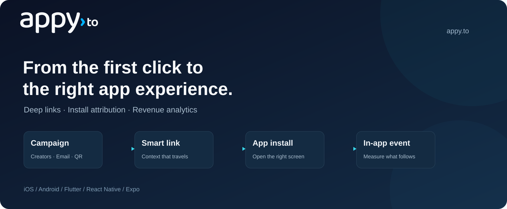

# Appy iOS SDK



Deep links, install attribution and in-app events for your iOS app.

**1.0.0** · iOS 13+ · Swift 5.9+ · [MIT](LICENSE)

[Step-by-step setup](QUICKSTART.md) · [Your dashboard values](SETUP.md) · [API reference](#api-reference) · [Support](mailto:support@appy.to)

## Quick start

### 1. Get your app's key and domain

In the [Appy dashboard](https://appy.to), open **Apps & SDK → New app**. Register your own app, then copy **Publishable key** and **Link domain** from **SDK setup**. The hosted SDK features require an Enterprise plan.

Replace `YOUR_PUBLISHABLE_KEY` and `your-app.appy.to` below with those two values. Keep the SDK/package names as written. [Help finding your values](SETUP.md).

### 2. Install

In Xcode, choose **File → Add Package Dependencies…**, enter the URL below, select `1.0.0` or later within major version 1, and add **AppySDK** to your app target.

```text
https://github.com/appy-to/appy-ios-sdk.git
```

### 3. Configure and connect links

Add `import AppySDK` at the top of your Swift file. Run this once during app startup:

```swift
Appy.configure(AppyConfiguration(
    publishableKey: "YOUR_PUBLISHABLE_KEY",
    linkDomains: ["your-app.appy.to"]
))
```

Finish the required iOS setup: [enable Associated Domains](#2-enable-associated-domains), then [forward incoming URLs and handle the result](#5-pass-incoming-links-to-the-sdk).

### 4. Test your first link

Create a link for this dashboard app, install the matching app build and tap the link. Confirm that your deep-link handler receives it before testing fresh installs or adding event tracking. [Follow the complete walkthrough](QUICKSTART.md).

---

## Detailed guide

The sections below cover platform settings, callbacks, events, consent, troubleshooting and the API. Start here when you need a specific integration detail.

<details>
<summary>Browse the detailed guide</summary>

- [Requirements and installation](#requirements-and-installation)
- [1. Register your app with Appy](#1-register-your-app-with-appy)
- [2. Enable Associated Domains](#2-enable-associated-domains)
- [3. Add a custom URL scheme](#3-add-a-custom-url-scheme)
- [4. Configure the SDK](#4-configure-the-sdk)
- [5. Pass incoming links to the SDK](#5-pass-incoming-links-to-the-sdk)
- [6. Handle deep links](#6-handle-deep-links)
- [7. Deferred deep links](#7-deferred-deep-links)
- [8. Install attribution](#8-install-attribution)
- [9. Track events](#9-track-events)
- [10. Identify users](#10-identify-users)
- [11. Privacy and opt-out](#11-privacy-and-opt-out)
- [12. Build share links](#12-build-share-links)
- [13. Debugging](#13-debugging)
- [Lightweight by design](#lightweight-by-design)
- [API reference](#api-reference)
- [For maintainers: publishing](#for-maintainers-publishing)

</details>

## Requirements and installation

- iOS 13.0 or later.
- Swift 5.9 or later (Xcode 15 or later). Built and tested with Xcode 26.6 and Swift 6.3.
- The package uses the Swift 5 language mode and works in both Swift 5 and Swift 6 apps.
- macOS 10.15 is supported only so the tests run on a Mac.
- An app registered with Appy on the Enterprise plan, and its publishable key (`appy_pk_…`).

The SDK is a public Swift package. To add it in Xcode:

1. Choose **File > Add Package Dependencies…** and enter `https://github.com/appy-to/appy-ios-sdk.git`.
2. Pick **Up to Next Major Version** from `1.0.0`.
3. Add the **AppySDK** library to your app target.

In a `Package.swift`:

```swift
dependencies: [
    .package(url: "https://github.com/appy-to/appy-ios-sdk.git", from: "1.0.0")
],
targets: [
    .target(name: "YourApp", dependencies: [.product(name: "AppySDK", package: "appy-ios-sdk")])
]
```

For CocoaPods, add to your app target and run `pod install`:

```ruby
pod 'AppySDK', :git => 'https://github.com/appy-to/appy-ios-sdk.git', :tag => '1.0.0'
```

## 1. Register your app with Appy

Open **Apps & SDK → New app** in the [Appy dashboard](https://appy.to). Use your own app's name, choose its link subdomain, enable iOS, and enter:

| Field | Where to find your value |
| --- | --- |
| Team ID | Apple Developer account → Membership details; use the team that signs your app |
| Bundle ID | Xcode → your app target → General → Bundle Identifier |

Select **Register app**. On that app's page, open **SDK setup** and copy its **Publishable key** and **Link domain**. If your product also runs on Android, add Android to the same dashboard app.

In the code below, replace `YOUR_PUBLISHABLE_KEY` with the entire copied key and `your-app.appy.to` with the copied domain. Keep names such as `Appy.configure` and `AppyConfiguration`: they are the library API, not the name of your app. [See the value-by-value explanation](SETUP.md).

Appy creates the domain-verification file for you. The next step tells iOS which domain belongs to your app. No `curl` command or secret API key is needed for this flow. Server-side registration automation is documented separately in the [developer API reference](https://api.appy.to/docs).

## 2. Enable Associated Domains

In Xcode, open your target's **Signing & Capabilities**, add **Associated Domains**, and enter `applinks:your-app.appy.to` with your own link domain:

```xml
<key>com.apple.developer.associated-domains</key>
<array>
    <string>applinks:your-app.appy.to</string>
</array>
```

Devices download the AASA file through Apple's CDN, which can lag behind by up to a day. While developing, add a second entry, `applinks:your-app.appy.to?mode=developer`. A development-signed build then fetches the file straight from Appy on a device where **Settings > Developer > Associated Domains Development** is on. Other builds use the regular entry, so keep both.

## 3. Add a custom URL scheme

In-app browsers (Instagram, Facebook, TikTok, many mail apps) often ignore Universal Links. The Appy redirect page then tries the link's deep link, such as `yourapp://items/42`, before falling back to the store. Register the scheme under your target's **Info > URL Types**, for example with identifier `com.example.yourapp` and URL scheme `yourapp`.

Appy appends `appy_click_id` to the custom-scheme URLs it opens. The SDK treats any URL with that parameter as an Appy link. `handle(url:)` returns `false` for your own custom-scheme URLs, so they reach your router untouched.

## 4. Configure the SDK

Configure once, as early as possible: in `application(_:didFinishLaunchingWithOptions:)` or in your SwiftUI `App` initializer.

```swift
import AppySDK

var configuration = AppyConfiguration(publishableKey: "YOUR_PUBLISHABLE_KEY", linkDomains: ["your-app.appy.to"])
#if DEBUG
configuration.logLevel = .debug
#endif
Appy.configure(configuration)
Appy.shared.onDeepLink = { result in
    if case .found(let link) = result {
        DeepLinkRouter.shared.open(link)
    }
}
```

| Property | Default | Meaning |
|---|---|---|
| `publishableKey` | required | Your `appy_pk_…` key. A key with any other prefix is logged as an error. Only the first 12 characters are ever logged. |
| `linkDomains` | `[]` | Hosts of your Appy links, matched case-insensitively. The first one is used by `link(slug:parameters:)`. Values like `https://your-app.appy.to/` and `applinks:your-app.appy.to` are normalized to the host. |
| `emailLinkDomains` | `[]` | Click-tracking domains of your email tool that open the app. See [Links in marketing email](#links-in-marketing-email). |
| `openDeferredDeepLinks` | `false` | When `true`, the SDK also opens a deferred link's `deeplinkURL` for you. See [Let the SDK open the link](#let-the-sdk-open-the-link). |
| `deferredDeepLinkTimeout` | `5` s | How long the first launch waits for Appy's answer before `onDeepLink` receives `.failed(.timeout)`. Zero, negative and non-finite values use 5 s. |
| `apiBaseURL` | `https://api.appy.to` | Change only for staging. |
| `logLevel` | `.error` | See [Debugging](#13-debugging). |
| `launchLinkWaitInterval` | `0.5` s | How long a launch waits for a link before opening the session without one. |
| `requestTimeout` | `10` s | Timeout per HTTP attempt. |

A second `configure` call is ignored with an error log.

## 5. Pass incoming links to the SDK

Both `handle` methods return `true` for Appy links, meaning the host is one of your `linkDomains` or the URL carries `appy_click_id`. For any other URL they return `false` and send nothing, so route those yourself.

**UIApplicationDelegate** (apps without scenes):

```swift
func application(_ app: UIApplication, open url: URL, options: [UIApplication.OpenURLOptionsKey: Any] = [:]) -> Bool {
    Appy.shared.handle(url: url) || MyURLRouter.open(url)
}

func application(_ application: UIApplication, continue userActivity: NSUserActivity,
                 restorationHandler: @escaping ([UIUserActivityRestoring]?) -> Void) -> Bool {
    Appy.shared.handle(userActivity: userActivity)
}
```

**UISceneDelegate.** A cold start delivers the link only in the connection options. The other two methods are called while the scene is running.

```swift
func scene(_ scene: UIScene, willConnectTo session: UISceneSession, options connectionOptions: UIScene.ConnectionOptions) {
    connectionOptions.userActivities.forEach { Appy.shared.handle(userActivity: $0) }
    connectionOptions.urlContexts.filter { !Appy.shared.handle(url: $0.url) }.forEach { MyURLRouter.open($0.url) }
}

func scene(_ scene: UIScene, continue userActivity: NSUserActivity) {
    Appy.shared.handle(userActivity: userActivity)
}

func scene(_ scene: UIScene, openURLContexts URLContexts: Set<UIOpenURLContext>) {
    URLContexts.filter { !Appy.shared.handle(url: $0.url) }.forEach { MyURLRouter.open($0.url) }
}
```

**SwiftUI.** Depending on the modifiers attached, SwiftUI delivers a Universal Link through `onOpenURL` or `onContinueUserActivity`. Attach both:

```swift
@main
struct YourApp: App {
    @StateObject private var router: DeepLinkRouter

    init() {
        let router = DeepLinkRouter()
        _router = StateObject(wrappedValue: router)
        Appy.configure(AppyConfiguration(publishableKey: "YOUR_PUBLISHABLE_KEY", linkDomains: ["your-app.appy.to"]))
        Appy.shared.onDeepLink = { router.handle($0) }
    }

    var body: some Scene {
        WindowGroup {
            RootView()
                .environmentObject(router)
                .onOpenURL { url in
                    if !Appy.shared.handle(url: url) { router.open(url) }
                }
                .onContinueUserActivity(NSUserActivityTypeBrowsingWeb) { Appy.shared.handle(userActivity: $0) }
        }
    }
}
```

**Push notifications and in-app messages.** Pass the link's URL to `handle(url:)` when the user taps the notification or the message; below, the payload carries it under a `link` key. An Appy link reaches `onDeepLink` as `.found` and counts as an app open for that link. Put the Appy link itself in the payload, not its `deeplinkURL`.

```swift
func userNotificationCenter(_ center: UNUserNotificationCenter, didReceive response: UNNotificationResponse,
                            withCompletionHandler completionHandler: @escaping () -> Void) {
    if let link = response.notification.request.content.userInfo["link"] as? String, let url = URL(string: link) {
        Appy.shared.handle(url: url)
    }
    completionHandler()
}
```

### Links in marketing email

Email tools wrap every link in a click-tracking URL on their own domain. When that domain serves an `apple-app-site-association` file for your app, a tap opens the app with the tracking URL, not with your link. List the domain in `emailLinkDomains`, add `applinks:` for it to Associated Domains, and keep passing URLs to `handle`:

```swift
var configuration = AppyConfiguration(publishableKey: "YOUR_PUBLISHABLE_KEY", linkDomains: ["your-app.appy.to"])
configuration.emailLinkDomains = ["links.example.com"]
Appy.configure(configuration)
```

- The SDK requests the tracking URL once and reads its `Location` header without following the redirect, the way SendGrid documents it, so your email tool counts the click. It keeps going only while the redirects stay on your email link domains, for at most 5 requests.
- An Appy link behind it is resolved like any other: `.found` with its slug, one open request, and on a cold start it is the launch link.
- Any other destination reaches `onDeepLink` as `.found` with that `url`, an empty `slug` and the URL's query parameters. Route it yourself.
- When the email tool cannot be reached or does not redirect, `.found` carries the tracking URL itself and an empty `slug`.
- Klaviyo's tracking domains need Klaviyo's own SDK; follow Klaviyo's guide for those.

The [AASA generator](https://appy.to/tools/aasa-assetlinks-generator?host=sendgrid) has presets for SendGrid, Braze and Klaviyo tracking domains, and the [validator](https://appy.to/tools/universal-link-validator?mode=email) traces a link from a test email.

**How a launch is resolved:**

- Each launch sends exactly one open request.
- If an Appy link arrives within `launchLinkWaitInterval` after `configure`, the request carries it. Otherwise the request goes out without a URL when the interval ends.
- An email link that arrives in that interval holds the request until the SDK knows where it points.
- On the first launch after install, the request without a URL is the one that asks Appy for a deferred link.
- Links that arrive later each send their own request.
- Links handled before `configure` are kept, up to 10, and resolved right after it. Until then the SDK cannot know your domains, so it returns `true` for any `http` or `https` URL and any URL with `appy_click_id`. Configure early.

## 6. Handle deep links

`onDeepLink` is called on the main thread with an `AppyDeepLinkResult`:

| Result | Meaning |
|---|---|
| `.found(link)` | An Appy link opened the app, or, on the first launch, Appy found the link that was tapped before the install (`link.isDeferred == true`). |
| `.notFound` | First launch only. Appy answered, and no Appy link led to this install. |
| `.failed(error)` | First launch only. No usable answer: `.timeout` when Appy did not answer within `deferredDeepLinkTimeout`; `.network` when Appy could not be reached, or was busy or unavailable (HTTP 429 or 5xx) through all retries; `.invalidResponse` when Appy rejected the request (another 4xx, such as an unknown key) or answered with something unreadable. The log has the details. |

When it is called:

- on the first launch after install, **exactly once**, with one of the three results;
- every time an Appy link opens the app, with `.found`;
- on no other launch.

An `AppyDeepLink` has:

| Property | Meaning |
|---|---|
| `url` | The Appy link, for example `https://your-app.appy.to/spring?item=42` |
| `deeplinkURL` | The in-app destination set on the link, for example `yourapp://items?item=42` |
| `slug` | The link's slug, for example `spring` |
| `parameters` | The link's query parameters, including any `utm_*`. Keys starting with `appy_` are reserved and never included. |
| `isDeferred` | `true` when the link was tapped before the app was installed |
| `clickedAt` | When the link was tapped, if known |

**SwiftUI**, with the router from the previous section:

```swift
@MainActor
final class DeepLinkRouter: ObservableObject {
    @Published var path: [Route] = []

    func handle(_ result: AppyDeepLinkResult) {
        guard case .found(let link) = result else { return }
        if let itemId = link.parameters["item"] {
            path = [.item(id: itemId)]
        } else {
            path = [.campaign(slug: link.slug)]
        }
    }

    func open(_ url: URL) {
        path = Route(url: url).map { [$0] } ?? []
    }
}
```

**UIKit:**

```swift
func application(_ application: UIApplication,
                 didFinishLaunchingWithOptions launchOptions: [UIApplication.LaunchOptionsKey: Any]?) -> Bool {
    Appy.configure(AppyConfiguration(publishableKey: "YOUR_PUBLISHABLE_KEY", linkDomains: ["your-app.appy.to"]))
    Appy.shared.onDeepLink = { result in
        switch result {
        case .found(let link):
            DeepLinkRouter.shared.open(link)
        case .notFound, .failed:
            Onboarding.start()
        }
    }
    return true
}
```

Parse `deeplinkURL` and navigate inside your app, or route on `slug` and `parameters`. Delivery rules:

- **Callback timing.** Set `onDeepLink` before or after `configure`. A result that arrives while no callback is set is delivered once, as soon as you set one. When several arrive, the most recent link wins, and a link is never replaced by a later `.notFound` or `.failed`.
- **Latest link.** `latestDeepLink` holds the most recent link, including a deferred link that arrived after the timeout.
- **Offline fallback.** When Appy cannot be reached for a link that opened the app, `.found` carries a link parsed from the URL itself: `url` is the URL, `slug` is its first path component on a link domain (empty otherwise), `parameters` are its query parameters, and `deeplinkURL` and `clickedAt` are `nil`. Make sure your routing also works from `slug` and `parameters`.
- **Testing your routing.** Build links with the public initializer, for example `AppyDeepLink(slug: "spring", parameters: ["item": "42"])`. Results are `Equatable`, so `result == .notFound` works in tests.

## 7. Deferred deep links

When someone taps an Appy link without your app installed, Appy remembers the tap and sends them to the App Store. On the first launch after install, the SDK asks Appy for that link and Appy matches the install to the link. The answer arrives through `onDeepLink`: `.found` with `isDeferred == true`, or `.notFound` when no Appy link led to the install.

- **Timeout.** The first launch waits at most `deferredDeepLinkTimeout` (5 seconds, counted from `configure`) and then delivers `.failed(.timeout)`. An answer that comes later does not call `onDeepLink` a second time. Its link goes to `latestDeepLink`, and its attribution still reaches `onAttribution`.
- **Retries.** Until Appy has answered a first launch, each launch asks again, and `onDeepLink` answers again on that launch.
- **Tracking off.** While `isTrackingEnabled` is `false`, the SDK does not ask for a deferred link and `onDeepLink` is not called for it. Turning tracking on starts the request and its timeout; see [Waiting for consent](#waiting-for-consent).
- **What to show meanwhile.** Most apps show their usual first screen and navigate when `.found` arrives. If you would rather hold a splash screen on your app's first run, `onDeepLink` answers within `deferredDeepLinkTimeout`. Later launches without a link do not call it, so do not wait for it there.

Deferred links on iOS work best when the app is installed and opened soon after the tap. When Appy cannot connect an install to a tap, the first launch gets `.notFound` and the install counts as organic.

### Let the SDK open the link

With `openDeferredDeepLinks = true`, the SDK calls `onDeepLink` and then opens the deferred link's `deeplinkURL` with `UIApplication.open`. Your app receives it like any other URL, through `application(_:open:options:)`, `scene(_:openURLContexts:)` or `onOpenURL`, so an app that already routes its own URL scheme needs no extra code.

```swift
var configuration = AppyConfiguration(publishableKey: "YOUR_PUBLISHABLE_KEY", linkDomains: ["your-app.appy.to"])
configuration.openDeferredDeepLinks = true
Appy.configure(configuration)
```

- The SDK only opens URLs with a scheme your app registers under **URL Types**, so it never sends the user to a web page. Other URLs are skipped with a warning in the log.
- It opens the link even if `onDeepLink` is not set, and only for a deferred link delivered within the timeout.
- Links that open an installed app are never reopened; the system already delivered them.
- If you also navigate on `.found` in `onDeepLink`, skip links with `isDeferred == true` there so the screen does not open twice.

### Strict attribution

Strict attribution is an app setting in the Appy dashboard, under **Apps & SDK >** your app **> Strict attribution**, and is off by default. It needs no change in the app. With it on, Appy counts only installs it can verify, and everything else is organic.

The App Store passes nothing from the tap to a new install, so with Strict attribution on, a first launch from the home screen reports `.notFound` and the install counts as organic. Links that open the installed app keep arriving as `.found`.

## 8. Install attribution

`onAttribution` tells you where the install came from. It is called once, on the main thread, when Appy answers the first launch:

```swift
Appy.shared.onAttribution = { attribution in
    if attribution.isOrganic {
        Analytics.setUserProperty("acquisition", value: "organic")
    } else {
        Analytics.setUserProperty("acquisition", value: attribution.campaign ?? attribution.linkSlug ?? "appy")
    }
}
```

| Property | Meaning |
|---|---|
| `isOrganic` | `true` when no Appy link led to the install |
| `linkSlug`, `linkTitle` | The link's slug and its title in the dashboard |
| `source`, `medium`, `campaign` | The `utm_source`, `utm_medium` and `utm_campaign` of the tapped link, when it had them |
| `clickedAt` | When the link was tapped |
| `network` | Set when an ad network's own data attributed the install: `name`, `campaignId`, `adGroupId`, `adId` and the other fields the network reports. `linkSlug` is then `nil`. |

- Set `onAttribution` before or after `configure`. If it is set later during that launch, it receives the attribution once when you set it.
- `Appy.shared.attribution` keeps the value across launches. It is `nil` until Appy has answered the first launch.
- The deep link timeout does not apply here: an answer that arrives after `.failed(.timeout)` is still delivered.

### Apple Ads

On the first launch the SDK reads the Apple Ads attribution token from AdServices (iOS 14.3 and newer) and sends it with the launch. Appy asks Apple's attribution API on the server, which needs no App Tracking Transparency prompt and no IDFA, and stores the campaign, ad group, keyword and ad on the install. Apple's answer can take a few seconds, so it is not part of `onAttribution`; it appears on the install in the dashboard, in `GET /v1/apps/{appId}/installs/{installId}` as `attribution.network`, and in install postbacks. The SDK loads AdServices at run time, so there is nothing to link. Turn the lookup off with the Apple Ads setting of your app in the dashboard.

Attribution on the device is for analytics and personalization. Before you pay a referral reward, check the install from your backend with `GET /v1/apps/{appId}/installs?userId=<user ID>` (see [Identify users](#10-identify-users)), and pay when its `attribution.verified` is `true`, which means Appy confirmed the link itself: it opened the app, or the store passed it to the install.

## 9. Track events

```swift
Appy.shared.track("signup")
Appy.shared.track("add_to_cart", properties: ["sku": "A1", "qty": 2, "gift": false])
Appy.shared.track("purchase", properties: ["order_id": "ord_981"], revenue: Decimal(string: "19.98"), currency: "USD")
```

| Rule | Otherwise |
|---|---|
| Name is 1-64 characters after trimming | The event is dropped (error log). |
| Property keys are 1-64 characters; values are strings, finite numbers or booleans | The property is dropped (debug log). |
| At most 50 properties | Properties after the first 50 in key order are dropped (debug log). |
| Strings are at most 512 characters | The string is truncated. |
| `revenue` is finite and below 10^12 in absolute value, with a three-letter `currency`, which is uppercased for you | `revenue` and `currency` are dropped (warning log). |
| `currency` comes with `revenue` | A currency without revenue is ignored. |
| `deduplicationId` is 1-128 printable ASCII characters without spaces after trimming | A generated ID is used and the event is kept (error log). |

Lengths count Unicode scalars. Negative revenue (refunds) is allowed. Create amounts with `Decimal(string: "19.98")`: a literal such as `revenue: 19.98` passes through `Double` and can arrive as `19.980000000000001`.

Each event gets an ID (your `deduplicationId` or a random one), a UTC timestamp and the current user ID. The queue lives in `Application Support/AppySDK/events.json` and survives restarts. The file is excluded from backups and holds at most 1,000 events, dropping the oldest first. The queue is sent:

- 2 seconds after the latest `track` call;
- immediately when 20 events are queued;
- when the app goes to the background, inside a background task;
- when you call `flush()`.

How sending works:

- Nothing is sent before the launch open has finished.
- Each batch holds at most 100 events and 256 KB.
- Accepted batches leave the queue.
- Events the server rejects one by one in a 202 response are logged as warnings and not resent, because they would never succeed.
- A 4xx other than 429 drops the whole batch with an error log.
- After network errors, 429 or 5xx, the events stay queued and are retried after 4, 8, 16… seconds (at most 5 minutes), or after the server's `Retry-After`.
- The server de-duplicates by event ID, so a resent batch counts once.

### Count each purchase once

A purchase can reach your code more than once: StoreKit delivers a transaction again when the app quit before `finish()`, a restore replays it, and your backend may report it too. Pass the store's transaction ID as `deduplicationId`, and Appy counts the purchase once.

```swift
let result = try await product.purchase()
if case .success(.verified(let transaction)) = result {
    Appy.shared.track(
        "purchase",
        properties: ["product_id": product.id],
        revenue: product.price,
        currency: product.priceFormatStyle.currencyCode,
        deduplicationId: String(transaction.id)
    )
    await transaction.finish()
}
```

- The ID is sent as the event's ID. Appy keeps one event per ID and app, so use an ID that belongs to a single purchase: `transaction.id`, which is new for every renewal, not `originalID` or the product ID. A later event with an ID Appy already has is not counted.
- If your backend also reports purchases, for example from App Store Server Notifications through `POST /v1/apps/{appId}/events`, pass the same transaction ID as the event `id` there. Appy then counts the purchase once, whichever side reports it first.
- A `track` call whose ID is still waiting in the queue is dropped with an info log; the queued event is the same purchase.
- An ID that is empty, longer than 128 characters, or contains spaces or characters outside printable ASCII is logged as an error, and the event is sent with a generated ID.

## 10. Identify users

```swift
Appy.shared.setUserId("u_123")
Appy.shared.setUserId(nil)
```

Call it after sign-in, and with `nil` on sign-out. The ID is trimmed, persisted and sent with later opens and events. An ID longer than 128 characters is rejected with an error log and clears the stored ID. Use an opaque internal ID, not an email address.

## 11. Privacy and opt-out

What the SDK sends:

| Data | With |
|---|---|
| Install ID: a random UUID created on first launch, stored in the app's `to.appy.sdk` suite and deleted with the app | Opens, events |
| The Appy link that opened the app, and the first-launch and tracking flags | Opens |
| User ID, if one is set and tracking is enabled | Opens, events |
| Platform `ios`, iOS version, model identifier such as `iPhone15,2`, locale | Opens |
| Bundle ID, app version, build | Opens |
| Event ID, name, properties, revenue, currency, timestamp | Events |

As with any HTTPS request, the server also sees the request's IP address. Appy turns it into a daily-rotating keyed hash for deferred deep linking and does not store the address; see [how attribution works and what is stored](https://appy.to/docs/attribution).

The SDK does not show an App Tracking Transparency prompt, does not read the IDFA and sends nothing to ad networks. Apple does not allow deriving data from a device to identify it uniquely, so review deferred deep linking with your privacy team. If you want only installs Appy can verify, turn on [Strict attribution](#strict-attribution) in the dashboard.

```swift
Appy.shared.isTrackingEnabled = false
```

The flag defaults to `true` and is persisted. When it is `false`:

- the event queue is deleted and new events are ignored;
- the launch open is skipped, and with it the deferred deep link and the install attribution;
- links your app passes to `handle(url:)` are still resolved, with `trackingEnabled: false` and without the user ID. The server stores nothing for them.

If you ask for consent first, see [Waiting for consent](#waiting-for-consent).

The package ships `PrivacyInfo.xcprivacy`, which declares:

- no tracking;
- the collected data types Device ID (the install ID), User ID, Product Interaction, Purchase History, Advertising Data (Apple Ads attribution) and Other Data Types (device model, OS version and locale), linked to the user, not used for tracking, for app functionality and analytics;
- the `UserDefaults` API with reason `CA92.1`.

You remain responsible for your App Store privacy details. [Privacy labels](https://appy.to/docs/sdk/privacy-labels) lists the answers for App Store Connect and Google Play with strict and standard attribution.

### Waiting for consent

Set `isTrackingEnabled` to `false` before `configure`, and to `true` once the user consents. The flag is persisted, so set it to `false` only while the user has not answered yet:

```swift
if !Consent.hasAnswered {
    Appy.shared.isTrackingEnabled = false
}
Appy.configure(configuration)

Consent.onAnswer = { granted in
    Appy.shared.isTrackingEnabled = granted
}
```

Before consent the SDK sends no launch open, no events and no user ID. Links your app passes to `handle(url:)` are still resolved, and the server stores nothing for them.

When tracking turns on, the first-launch lookup, its `deferredDeepLinkTimeout` and `onDeepLink` start at that moment, also when the user consents on a later launch. The install attribution follows through `onAttribution`. If an Appy link opened the app earlier in the same launch, the lookup waits for the next launch.

### Deleting a user's data

To erase one user's installs and events, call `DELETE /v1/apps/{appId}/installs?userId=<user ID>` from your backend with a secret key. It removes every install and event tied to that user ID, so call [`setUserId`](#10-identify-users) after sign-in. Deleting is permanent; see the [REST API reference](https://appy.to/docs/api).

## 12. Build share links

```swift
let url = Appy.shared.link(slug: "spring", parameters: ["item": "42", "ref": referralCode])
```

This returns `https://your-app.appy.to/spring?item=42&ref=…`:

- the host is the first link domain;
- the slug is lowercased and must match `^[a-z0-9-]{1,64}$`;
- parameters are sorted by key and percent-encoded;
- the result is `nil` before `configure`, without a link domain, or for an invalid slug.

The method only builds the URL, so the slug must belong to a link in your account. Keys starting with `appy_` are reserved.

## 13. Debugging

Logs go to the unified log with subsystem `to.appy.sdk` and category `Appy`, prefixed with `[Appy]`, and appear in the Xcode console. The levels, from quiet to verbose:

| Level | Logs |
|---|---|
| `.none` | Nothing |
| `.error` | Misconfiguration, failed requests with the server's code and message, dropped events, invalid deduplication IDs |
| `.warning` | Also rejected events, retries, invalid revenue, a first launch that timed out, and a deferred link the SDK did not open |
| `.info` | Also configuration, attribution, sent batches, duplicate events and local fallbacks |
| `.debug` | Also every request and decision |

In Console.app, filter on `subsystem:to.appy.sdk` and turn on **Include Info Messages** and **Include Debug Messages**.

Check the association file, and what Apple's CDN serves to devices:

```bash
curl -i https://your-app.appy.to/.well-known/apple-app-site-association
curl -i https://app-site-association.cdn-apple.com/a/v1/your-app.appy.to
```

Expect `200`, JSON, no redirect, and `YOUR_APPLE_TEAM_ID.com.example.yourapp` in the `applinks` section. **Settings > Developer > Universal Links > Diagnostics** tests a URL on a device. `xcrun simctl openurl booted https://your-app.appy.to/spring` opens one in the Simulator.

**Common pitfalls:**

- A link typed or pasted into Safari's address bar opens the website. Universal Links react to taps, so test from Notes or Messages.
- A tap on a page of the same domain stays in Safari.
- Choosing "Open in Safari" turns Universal Links off for that domain on that device. Long-press a link and choose your app to turn them back on.
- A scene-based app gets the cold-start link in `connectionOptions`, not in `scene(_:continue:)`.
- The Team ID registered with Appy must be the one that signs the build.
- The CDN caches the AASA file, so use `?mode=developer` while developing.
- `handle(url:)` returns `false` for URLs that are not Appy links.
- With `openDeferredDeepLinks`, a `deeplinkURL` whose scheme is not under **URL Types** is not opened; the log says so.

### Testing deferred deep links

1. Delete the app from the phone.
2. On the same phone, tap an Appy link, for example in Notes or Messages. It opens the store or the link's fallback page; you do not need to install from there.
3. Install your build from Xcode or TestFlight.
4. Open the app.

Every install gets a new random install ID, so there is no test device to register and nothing to reset in Appy. To test again, repeat the same steps; each tap is a new click.

With `configuration.logLevel = .debug`, the console shows Appy's answer: `Opening session (firstLaunch true, url none)`, then `The install is attributed to spring.`, and `onDeepLink` receives `.found`.

## Lightweight by design

The SDK uses Apple platform frameworks and has no external Swift package dependencies. Network requests and queued events are handled away from the main thread; link callbacks arrive on the main thread. The package includes its privacy manifest.

For the data your app sends and the consent controls available to you, see [Privacy and opt-out](#11-privacy-and-opt-out). Implementation details and size measurements are not needed to follow the setup above.

## API reference

| `Appy` | |
|---|---|
| `static let shared: Appy` | The SDK instance |
| `static let sdkVersion: String` | `"1.0.0"`, also sent as `X-Appy-SDK: ios/1.0.0` |
| `static func configure(_ configuration: AppyConfiguration)` | Starts the SDK. Call once, early. |
| `var onDeepLink: ((AppyDeepLinkResult) -> Void)?` | Called on the main thread, once on the first launch and for each Appy link that opens the app |
| `var onAttribution: ((AppyAttribution) -> Void)?` | Called on the main thread once, when Appy answers the first launch |
| `var attribution: AppyAttribution? { get }` | The install's attribution, kept across launches |
| `var latestDeepLink: AppyDeepLink? { get }` | The most recent link |
| `@discardableResult func handle(url: URL) -> Bool` | Resolves an Appy link; `false` for other URLs |
| `@discardableResult func handle(userActivity: NSUserActivity) -> Bool` | Resolves the `webpageURL` of a web-browsing activity |
| `func track(_ name: String, properties: [String: Any] = [:], revenue: Decimal? = nil, currency: String? = nil, deduplicationId: String? = nil)` | Queues an event |
| `func setUserId(_ userId: String?)` | Sets or clears the user ID (at most 128 characters) |
| `var isTrackingEnabled: Bool { get set }` | Persisted opt-out, default `true` |
| `func link(slug: String, parameters: [String: String] = [:]) -> URL?` | Builds a share link |
| `func flush()` | Sends queued events now, within the rules above |

The other public types:

- **`AppyConfiguration`** has `init(publishableKey:linkDomains:)` and the properties in [Configure the SDK](#4-configure-the-sdk).
- **`AppyDeepLinkResult`** is an `Equatable`, `Sendable` enum: `found(AppyDeepLink)`, `notFound`, `failed(AppyError)`.
- **`AppyDeepLink`** is `Equatable` and `Sendable`. It has the properties in [Handle deep links](#6-handle-deep-links) and a public initializer where every argument except `slug` has a default.
- **`AppyAttribution`** is `Equatable` and `Sendable`. It has the properties in [Install attribution](#8-install-attribution) and a public initializer where every argument except `isOrganic` has a default.
- **`AppyError`** is an `Error`: `timeout`, `network`, `invalidResponse`.
- **`AppyLogLevel`** is an `Int`-backed, `Comparable` enum: `none`, `error`, `warning`, `info`, `debug`.

All public methods are safe to call from any thread. `track`, `setUserId`, `flush` and the setters return immediately. `handle`, `link` and the getters wait only for the SDK's queue, never for the network.

Each request carries `Authorization: Bearer <publishable key>`, `Content-Type: application/json`, `Accept: application/json` and `X-Appy-SDK`. Network errors, 429 and 5xx responses are retried up to three attempts in total, after about 1 and 2 seconds, or after a `Retry-After` of at most 10 seconds. Other 4xx responses are not retried.

## For maintainers: publishing

The SDK lives in `sdks/ios` of the Appy monorepo. SwiftPM needs `Package.swift` at a repository root, so releases go to a dedicated repository split from that folder.

1. Update `Appy.sdkVersion` in `Sources/AppySDK/Appy.swift` and add the release to `CHANGELOG.md`. The tag must equal `Appy.sdkVersion`.
2. From `sdks/ios`, run `swift build`, `swift test`, `xcodebuild -scheme AppySDK -destination 'generic/platform=iOS Simulator' build` and `xcodebuild test -scheme AppySDK -destination 'platform=iOS Simulator,name=<an installed iPhone simulator>'`.
3. If the source changed, remeasure [Lightweight by design](#lightweight-by-design):
   - count non-blank lines in `Sources/AppySDK/*.swift`;
   - build with `xcodebuild -scheme AppySDK -destination generic/platform=iOS -configuration Release build CODE_SIGNING_ALLOWED=NO CLANG_COVERAGE_MAPPING=NO` and take the size of `AppySDK.o`;
   - link a minimal app that calls the public API against that `AppySDK.o` with `swiftc -target arm64-apple-ios13.0 -O … -Xlinker -dead_strip -Xlinker -map -Xlinker app.map`, and add up the sizes of the symbols that `app.map` attributes to `AppySDK.o`.
4. Commit, then publish the folder's history and the version tag from the monorepo root. Without `--push` the script only prints the split commit:

   ```bash
   sdks/scripts/mirror-sdk.sh ios git@github.com:appy-to/appy-ios-sdk.git --push
   ```

   `git subtree split` produces the same commits for the same history, so each release fast-forwards `main`. The script refuses to move a tag that already exists.
5. `AppySDK.podspec` at the package root reads its version from `Appy.sdkVersion`. CocoaPods trunk no longer accepts new pods, so CocoaPods users install with `pod 'AppySDK', :git => '<repository URL>', :tag => '<version>'`; check it with `pod lib lint AppySDK.podspec`.
6. Add the package to a clean app project with **File > Add Package Dependencies…**, and with the `pod` line above, before announcing the release. The private monorepo release guide (`sdks/RELEASING.md`) has the order across all SDKs.
